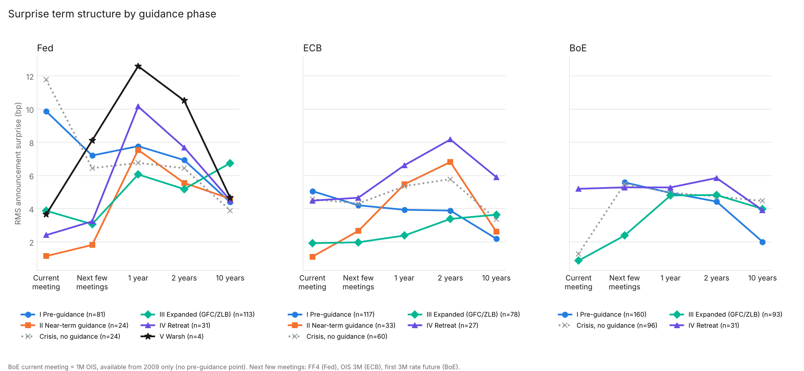
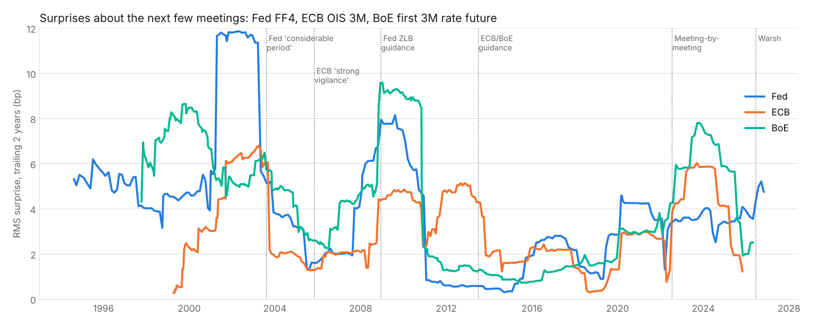
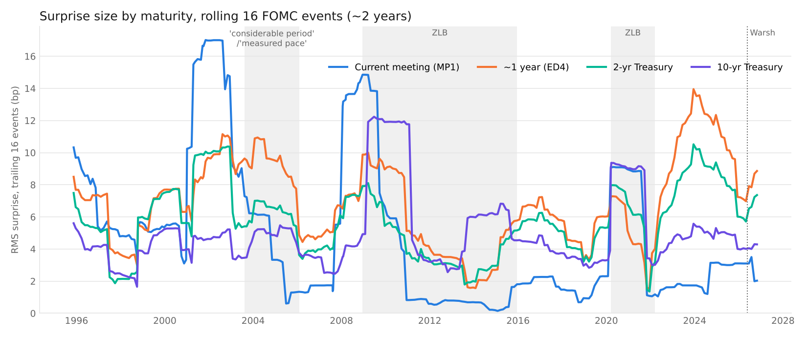

# Forward guidance by horizon: introduced, expanded, retreating

### Announcement surprises at the Fed, ECB and Bank of England, 1994–2026

*Empirical note, draft, November 2026. Code: `scripts/10_forward_guidance_note.py`, `11_fg_cross_country.py`, `12_fg_phases.py`. Data: SF Fed USMPD (277 FOMC events, Feb 1994 – Oct 2026), ECB EA-MPD (315 meetings, Jan 1999 – Oct 2025), BoE UKMPD (380 MPC decisions, Jun 1997 – Apr 2026).*

## 1. The question

Forward guidance is under criticism, and the debate covers every horizon. It covers medium-term commitments such as calendar dates, thresholds and the dots. It also covers near-term guidance about the next few meetings: "considerable period", "measured pace", "ongoing increases". At the Fed, the ECB and the Bank of England, guidance went through three phases:

1. **Introduced (early 2000s).** Near-term guidance arrived as a new practice: the Fed's "considerable period" (August 2003) and "measured pace", and the ECB's "strong vigilance" code (late 2005). It was revolutionary at the time.
2. **Expanded and broadened in the GFC.** At the lower bound, guidance extended to calendar dates, thresholds, state-contingent commitments and published rate paths, while near-term predictability became standard practice. Guidance became the norm.
3. **Retreat (2022 onward).** In July 2022 all three central banks dropped medium-term guidance for "meeting-by-meeting" decisions. More recent communication suggests even less. At his first FOMC meeting (June 17, 2026) Kevin Warsh cut the statement down and said "We've dropped forward guidance."

**Measurement idea.** Guidance at a given horizon should show up as small announcement-day surprises at that horizon, because markets already know what is coming. So the size of the surprise at each point on the curve shows how much guidance is in effect at that horizon:

* the current meeting
* the next few meetings
* one year
* two years
* ten years

This note traces that "surprise term structure" through the three phases at all three central banks.

## 2. Measurement

All three databases record tight-window changes around each policy announcement. The window is 30 minutes, extended to cover the press conference when there is one; for the UK the MPC announcement and any same-day press conference are summed. Horizons are matched as closely as the data allow:

| Horizon | Fed (USMPD) | ECB (EA-MPD) | BoE (UKMPD) |
|---|---|---|---|
| Current meeting | MP1 (Kuttner) | OIS 1M | OIS 1M (2009 on only) |
| Next few meetings | FF4 (~3 months) | OIS 3M | first 3-month rate future (Libor; SONIA from 2021) |
| ~1 year | ED4 (Eurodollar/SOFR future) | OIS 1Y | 1-yr gilt |
| 2 years | UST2Y | Bund 2Y | 2-yr gilt |
| 10 years | UST10Y | Bund 10Y | 10-yr gilt |

**Phases** (date = first meeting of the phase):

| Phase | Fed | ECB | BoE |
|---|---|---|---|
| I Pre-guidance | Feb 1994 | Jan 1999 | Jun 1997 |
| II Near-term guidance introduced | Aug 2003 ("considerable period", "measured pace") – Jun 2006 | Nov 2005 ("strong vigilance") – Jul 2008 | none |
| No explicit guidance / crisis | Aug 2006 – Oct 2008 | Aug 2008 – Jun 2013 | Aug 2007 – Jul 2013 |
| III Expanded (GFC / lower bound) | Dec 2008 ("for some time") – Jun 2022 | Jul 2013 – Jun 2022 | Aug 2013 (Carney) – Jun 2022 |
| IV Retreat: meeting-by-meeting | Jul 27, 2022 | Jul 21, 2022 | Aug 2022 |
| V Warsh | Jun 2026 (4 meetings) | | |

**Statistics.** The headline statistic is the root-mean-square (RMS) surprise in bp at each horizon. Differences between phases are tested with one-sided permutation tests. The Fed sample keeps intermeeting moves, with scheduled-meeting-only results as a check; non-policy unscheduled events with MP1 = 0 are dropped. Full tables are in `fg_note/phase_table.csv` and `phase_tests.csv`.

## 3. The surprise term structure through the three phases

**RMS announcement surprise (bp)**

| | Phase | n | Current mtg | Next few mtgs | 1Y | 2Y | 10Y |
|---|---|---|---|---|---|---|---|
| **Fed** | I Pre-guidance 1994–2003 | 81 | 9.9 | 7.2 | 7.8 | 6.9 | 4.4 |
| | II Near-term guidance 2003–06 | 24 | **1.1** | **1.8** | 7.5 | 5.6 | 4.6 |
| | No explicit guidance 2006–08 | 24 | 11.8 | 6.4 | 6.8 | 6.4 | 3.9 |
| | III Expanded 2008–22 | 113 | 3.9 | 3.1 | 6.1 | 5.2 | 6.8 |
| | IV Retreat 2022–May 2026 | 31 | 2.4 | 3.2 | **10.2** | **7.7** | 4.5 |
| | V Warsh Jun–Oct 2026 | 4 | 3.6 | **8.1** | **12.6** | **10.5** | 4.7 |
| **ECB** | I Pre-guidance 1999–2005 | 117 | 5.1 | 4.2 | 3.9 | 3.9 | 2.2 |
| | II "Strong vigilance" 2005–08 | 33 | **1.1** | 2.7 | 5.5 | 6.8 | 2.6 |
| | No guidance, crisis 2008–13 | 60 | 4.6 | 4.3 | 5.4 | 5.8 | 3.4 |
| | III Expanded 2013–22 | 78 | **1.9** | **2.0** | **2.4** | **3.4** | 3.6 |
| | IV Retreat 2022–Oct 2025 | 27 | **4.5** | **4.7** | **6.6** | **8.2** | 5.9 |
| **BoE** | I Pre-guidance 1997–2007 | 160 | n/a | 5.6 | 5.0 | 4.4 | 2.0 |
| | No guidance, crisis/0.5% 2007–13 | 96 | 1.3 | 5.5 | 5.0 | 4.7 | 4.5 |
| | III Expanded (Carney) 2013–22 | 93 | 0.9 | **2.4** | 4.8 | 4.8 | 4.0 |
| | IV Retreat 2022–Apr 2026 | 31 | **5.2** | **5.3** | 5.3 | 5.9 | 3.9 |

**Permutation tests, one-sided p-values** (is the later phase smaller (↓) or larger (↑)?)

| Transition | Current | Next few | 1Y | 2Y | 10Y |
|---|---|---|---|---|---|
| Fed I → II ↓ | **<0.001** | **<0.001** | 0.48 | 0.35 | 0.60 |
| Fed no-guidance 2006–08 → III ↓ | **0.014** | **0.005** | 0.29 | 0.15 | 0.76 |
| Fed III → IV ↑ | 0.60 | 0.38 | **0.003** | **0.013** | 0.63 |
| Fed IV → V Warsh ↑ | 0.13 | **0.002** | 0.20 | 0.14 | 0.36 |
| Fed III → V Warsh ↑ | 0.11 | **0.037** | **0.037** | **0.024** | 0.36 |
| ECB I → II ↓ | **<0.001** | 0.32 | 0.89 | 0.96 | 0.84 |
| ECB crisis → III ↓ | **0.010** | **0.002** | **<0.001** | **0.003** | 0.64 |
| ECB III → IV ↑ | 0.057 | **0.013** | **<0.001** | **<0.001** | **0.023** |
| BoE crisis → III ↓ | 0.20 | **0.036** | 0.44 | 0.53 | 0.27 |
| BoE III → IV ↑ | **<0.001** | **0.011** | 0.33 | 0.24 | 0.49 |

### Finding 1: introducing near-term guidance was a sharp break at the horizon it targeted

* **Fed.** With "considerable period" and "measured pace" (Aug 2003 – Jun 2006):
  * Current-meeting surprises fell from 9.9 bp to 1.1 bp, and surprises about the next few meetings from 7.2 bp to 1.8 bp (both p < 0.001).
  * Not one of the 24 meetings produced a 5 bp surprise at either horizon. Before 2003, a quarter to a third of meetings did.
  * The 1–2 year sector did not change (p = 0.35–0.48). Guidance worked exactly at the horizon it addressed.
* **ECB.** "Strong vigilance" did the same for the current meeting (5.1 → 1.1 bp, p < 0.001). Its 2-year surprises rose, from 3.9 bp to 6.8 bp.
* **When the guidance was dropped, the surprises came back.** After Bernanke dropped "measured pace" in mid-2006 and before the GFC guidance began, Fed near-term surprises returned to pre-2003 levels.
  * Including intermeeting cuts: current meeting 11.8 bp, next few meetings 6.4 bp.
  * Scheduled meetings only: 6.9 bp and 6.4 bp.

  That reversal is evidence that the 2003–06 calm was caused by the guidance, not by a general trend towards predictability.

At the time this was a revolution. In one step, the next meeting stopped being news.

### Finding 2: the GFC expanded guidance to longer horizons and made near-term predictability the norm

The GFC-era guidance kept the near term pinned and added longer horizons. From 2009 to 2022, surprises about the next few meetings stayed around 1–3 bp at all three banks for about a decade (figure 8). That is the sense in which guidance "became the norm". How far out it reached differed by bank:

* **ECB (2013–22).** Every horizon out to 2 years fell against 2008–13: current meeting 4.6 → 1.9 bp, next few meetings 4.3 → 2.0, 1-year 5.4 → 2.4, 2-year 5.8 → 3.4 (all p ≤ 0.01). The 10-year did not fall.
* **Fed.** Near-term surprises fell against 2006–08 (p = 0.014 for the current meeting, p = 0.005 for the next few meetings). In the zero-lower-bound years alone (2009–15), 1- and 2-year surprises fell to 4.6 and 3.9 bp, while 10-year surprises nearly doubled to 7.6 bp. Calendar guidance, thresholds and QE moved the remaining news out to term premia and to the expected length of the zero-rate period. (The full phase III average also includes the 2015–19 normalization, when 1–2 year surprises recovered.)
* **BoE.** Carney's guidance lowered surprises about the next few meetings (5.5 → 2.4 bp, p = 0.036). It did not lower 1–2 year surprises (p ≈ 0.5). The UK current meeting was already pinned at the 0.5% Bank Rate.

### Finding 3: the 2022 retreat reached the near term at the ECB and BoE, but not at the Fed

All three dropped medium-term guidance in July–August 2022. They differ in how far the retreat reached into the near term:

* **Fed: medium-term guidance withdrawn, near-term guidance kept.**
  * 1- and 2-year surprises jumped (6.1 → 10.2 bp and 5.2 → 7.7 bp; p = 0.003 and 0.013).
  * Current-meeting and next-few-meetings surprises did not rise (2.4 and 3.2 bp; p = 0.60 and 0.38). Only 6% of meetings brought a 5 bp surprise about the next few meetings.
  * The FOMC kept giving near-term direction ("ongoing increases will be appropriate", then "the extent of additional policy firming"), and decisions were signalled before meetings.
  * In the 2022–23 hikes, 47% of meetings brought a 5 bp or larger 2-year move with no surprise about the decision.
* **ECB: the retreat covered the whole near term.**
  * Every horizon rose: current meeting 1.9 → 4.5 bp (p = 0.057; 2.5 bp without the March 2023 SVB meeting), next few meetings 2.0 → 4.7 (p = 0.013), 1-year 2.4 → 6.6, 2-year 3.4 → 8.2 (both p < 0.001).
  * Even the 10-year rose (3.6 → 5.9 bp, p = 0.023).
* **BoE: the retreat was concentrated at the near term.**
  * Current-meeting surprises rose from 0.9 to 5.2 bp (p < 0.001) and next-few-meetings surprises from 2.4 to 5.3 bp (p = 0.011).
  * The 1–2 year sector barely changed. A 5 bp current-meeting surprise came at 23% of decisions, against 1% in 2013–22.
  * With softer guidance from August 2024 ("gradual and careful"), next-few-meetings surprises fell back to 2.6 bp. That is a partial return to near-term guidance.

Comparing the same calendar windows (2013–19 vs Jul 2022 – Oct 2025) controls for the common inflation shock. 2-year surprises rose 1.6x at the Fed, 1.7x at the BoE and 2.6x at the ECB, the bank whose retreat went furthest (`fg_note/common_windows.csv`).

### Finding 4: Warsh is the first Fed retreat to reach the near term

Over Warsh's four meetings, surprises about the next few meetings (FF4) are 8.1 bp:

* That is 2.5x the 2022–26 level (p = 0.002).
* Three of the four meetings had a 5 bp or larger surprise about the next few meetings. In 2022–26, 6% of meetings did.
* 1- and 2-year surprises are also high (12.6 and 10.5 bp; p = 0.037 and 0.024 against phase III).

The current meeting is still pre-signalled (3.6 bp, p = 0.13). So the Warsh Fed has gone further than Powell's 2022 retreat, by removing guidance about the next few meetings, the "considerable period" horizon. It still does not surprise markets on the day's decision. Two meetings stand out:

* **June 2026.** MP1 was zero, yet the 2-year rose 14 bp and the next-few-meetings contract 10 bp.
* **July and October 2026.** The 2-year fell while the 10-year rose (+2 bp each time). A move of 2-year down at least 3 bp with 10-year up at least 2 bp happened at only 2 of the 273 earlier FOMC events (Sept 17, 2001 and Nov 4, 2009).

### Finding 5: guidance also changes where the news arrives

The ECB data split the press release from the press conference (figure 6).

* Under "strong vigilance", 98% of the squared 2-year surprise arrived in the press conference, where the code words were delivered.
* With formal guidance written into the statement (2013–22), the press-conference share fell to 0.55.
* After the 2022 retreat, 99% of the current-meeting surprise arrives in the press release, with the decision itself.

## 4. Caveats

* **Warsh.** Four meetings is not a regime. June 2026 combines a new chair, a new statement format and projections showing hikes, so first-meeting news and the removal of guidance cannot yet be separated.
* **Retreat confounded with hikes.** The 2022 retreat coincides with the largest hiking cycles in decades. The ECB's July 2022 meeting also brought a surprise 50 bp hike and a new crisis tool (TPI). The common-window comparison helps but does not remove this.
* **Mechanical floor at the lower bound.** Small surprises in phase III partly reflect the floor. Two points argue against that being the whole story: near-term surprises stayed small after liftoff (Fed scheduled meetings 2016–19, and 2022–26), and they rose at the ECB and BoE once guidance was dropped, with policy rates well above zero.
* **Instruments.** The BoE "next few meetings" measure is a 3-month rate future, which reaches further than FF4 or OIS 3M, and BoE current-meeting data begin in 2009. ED4 switches from Eurodollar to SOFR futures in 2022. The ECB met twice a month until November 2001.
* **Windows.** Event windows lengthen with press conferences (Fed from 2011, at every meeting from 2019), which mechanically adds path news later in the sample.
* **Advance signalling.** The announcement window measures only what was not signalled beforehand. Speeches before the pre-meeting quiet period are part of near-term guidance but are not observed here.

## 5. Implications and research questions

1. **How far down the curve will the retreat go?** Medium-term guidance was dropped everywhere in 2022. The ECB and BoE retreat then reached the next few meetings, and the Fed's has now done so under Warsh. The next-few-meetings measure (figure 8) is the natural indicator to track. The BoE's partial return in 2024–26 shows the retreat can reverse. Is the current-meeting floor the last thing to go, or will the Warsh Fed eventually surprise markets on its decisions as it did before 2003?
2. **Why did the early-2000s change happen and stick?** Aug 2003 at the Fed and Nov 2005 at the ECB are sharp breaks. A structural-break test (Bai–Perron on the event-level series, by horizon and bank) would date the breaks formally. It would also test whether the norm formed at the introduction or only in the GFC, and whether the 2006–08 reversal is a real lapse.
3. **Does the horizon of guidance matter for transmission?** Code-word guidance pinned the next meeting but left 1–2 years untouched. Formal ECB guidance pinned out to 2 years. Splitting the dashboard's pass-through estimates (`02_production_estimates.py`, 2-year to corporate yields and equities) by phase and horizon would show which horizon of guidance matters for financial conditions.
4. **Does guidance reduce total uncertainty, or move it along the curve?** In 2003–06, guidance moved surprises from the front to 1–2 years. At the Fed's lower bound it moved them to the 10-year. Critics argue guidance builds up surprises that are released when it ends (the 2013 taper tantrum, Fed Mar–Jul 2022 with 1-year surprises of about 14 bp). This could be tested by summing surprise variance across horizons by phase and looking at guidance exits event by event.
5. **The ECB's 2022 exit as a template for Warsh, and a cross-country difference-in-differences.** Each bank's guidance changes (ECB/Fed July 2022, BoE 2013 and 2024, Fed 2026) can be compared using the other two as controls for global shocks. Does Warsh's near-term retreat settle at the ECB's 2022–25 levels or go further?
6. **Is the 2-year-down/10-year-up twist a credibility or term-premium channel?** Decomposing the July and October 2026 meetings with TIPS (inflation compensation vs real yields) would show whether long-end selloffs on dovish front-end news reflect inflation risk premia under a less predictable Fed.
7. **Measure advance signalling directly.** Add high-frequency surprises around speeches (Swanson–Jayawickrema style) and the minutes (USMPD has a Minutes sheet), plus the Bauer–Swanson (2023) orthogonalized surprise. The question is whether near-term guidance under Warsh has moved from the statement to speeches, or has really gone away.

---

## Appendix: detail by chair and era

Finer eras for the Fed, and the corresponding ECB and BoE eras (scripts `10_` and `11_`). Path share is the Gürkaynak–Sack–Swanson split of [MP1, FF4, ED2–ED4] into target and path factors: path² / (path² + target²). "Guidance events" are meetings with |MP1| < 1 bp and |2Y| ≥ 5 bp. Tables: `fg_note/era_table.csv`, `era_table_ea.csv`, `era_table_uk.csv`.

**Fed (RMS surprise, bp)**

| Era | n | MP1 | FF4 | ED4 | 2Y | 10Y | 2Y/10Y | Path share | Guidance events |
|---|---|---|---|---|---|---|---|---|---|
| Greenspan 1994–99 | 50 | 7.2 | 4.8 | 6.8 | 6.1 | 4.6 | 1.34 | 0.46 | 4% |
| Greenspan 2000–03 | 31 | 13.1 | 9.9 | 9.1 | 8.1 | 4.1 | 1.96 | 0.24 | 3% |
| Greenspan Aug 2003–Jan 2006 | 21 | 1.2 | 1.5 | 7.7 | 5.6 | 4.7 | 1.18 | 0.92 | 19% |
| Bernanke 2006–08 | 28 | 11.3 | 7.0 | 8.3 | 6.7 | 4.1 | 1.63 | 0.33 | 7% |
| ZLB 2009–15 | 55 | 1.1 | 1.2 | 4.6 | 3.9 | 7.6 | 0.51 | 0.89 | 16% |
| Normalization 2015–20 | 35 | 5.4 | 3.5 | 6.0 | 5.5 | 3.7 | 1.49 | 0.56 | 11% |
| ZLB 2020–22 | 19 | 4.5 | 1.6 | 4.4 | 5.4 | 8.3 | 0.65 | 0.59 | 5% |
| Powell 2022–23 | 15 | 1.8 | 3.9 | 14.0 | 10.5 | 5.5 | 1.90 | 0.96 | 47% |
| Powell 2024–May 2026 | 19 | 2.9 | 3.6 | 6.9 | 5.6 | 3.8 | 1.50 | 0.79 | 37% |
| Warsh Jun–Oct 2026 | 4 | 3.6 | 8.1 | 12.6 | 10.5 | 4.7 | 2.26 | 0.89 | 25% |

**ECB and BoE, finer eras** (front = OIS 1M for the ECB, first 3-month rate future for the BoE)

| Era | n | Front | 1Y | 2Y | 10Y | 2Y/10Y | Path share |
|---|---|---|---|---|---|---|---|
| ECB Duisenberg 1999–2003 | 93 | 5.7 | 4.2 | 4.1 | 2.2 | 1.85 | 0.24 |
| ECB Trichet 2003–05 (rates on hold) | 24 | 1.1 | 2.6 | 3.2 | 2.2 | 1.46 | 0.82 |
| ECB "strong vigilance" 2005–08 | 33 | 1.1 | 5.5 | 6.8 | 2.6 | 2.61 | 0.95 |
| ECB crisis 2008–13 | 60 | 4.6 | 5.4 | 5.8 | 3.4 | 1.72 | 0.51 |
| ECB forward guidance 2013–22 | 78 | 1.9 | 2.4 | 3.4 | 3.6 | 0.93 | 0.46 |
| ECB meeting-by-meeting 2022–25 | 27 | 4.5 | 6.6 | 8.2 | 5.9 | 1.38 | 0.63 |
| BoE MPC 1997–2007 | 160 | 5.6 | 5.0 | 4.4 | 2.0 | 2.21 | 0.23 |
| BoE crisis cuts 2007–09 | 26 | 10.2 | 7.3 | 6.9 | 3.6 | 1.89 | 0.17 |
| BoE 0.5%, no guidance 2009–13 | 70 | 1.7 | 3.7 | 3.6 | 4.7 | 0.77 | 0.82 |
| BoE Carney guidance 2013–20 | 73 | 1.8 | 2.7 | 3.0 | 3.0 | 1.01 | 0.53 |
| BoE COVID lower bound 2020–21 | 15 | 2.1 | 6.2 | 5.8 | 5.2 | 1.12 | 0.71 |
| BoE hikes 2021–24 | 21 | 6.9 | 8.3 | 8.5 | 5.9 | 1.45 | 0.48 |
| BoE cuts, "gradual and careful" 2024–26 | 15 | 2.6 | 5.6 | 6.0 | 3.4 | 1.76 | 0.88 |

---
*Reproduce:* `cd scripts && python3 00_fetch_usmpd.py && python3 00_fetch_intl_mpd.py && python3 10_forward_guidance_note.py && python3 11_fg_cross_country.py && python3 12_fg_phases.py`. This needs pandas, numpy, statsmodels, matplotlib and openpyxl. The Bank of England site can refuse scripted downloads; if so, the fetch script prints the URL and the file name to save it under.
