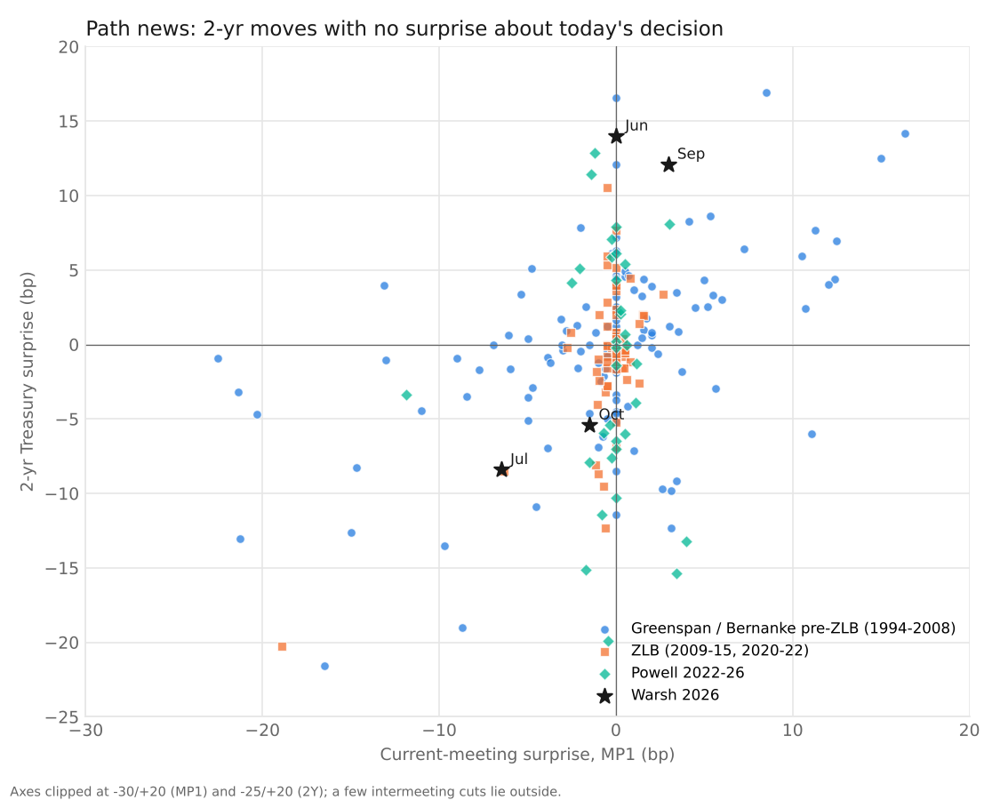
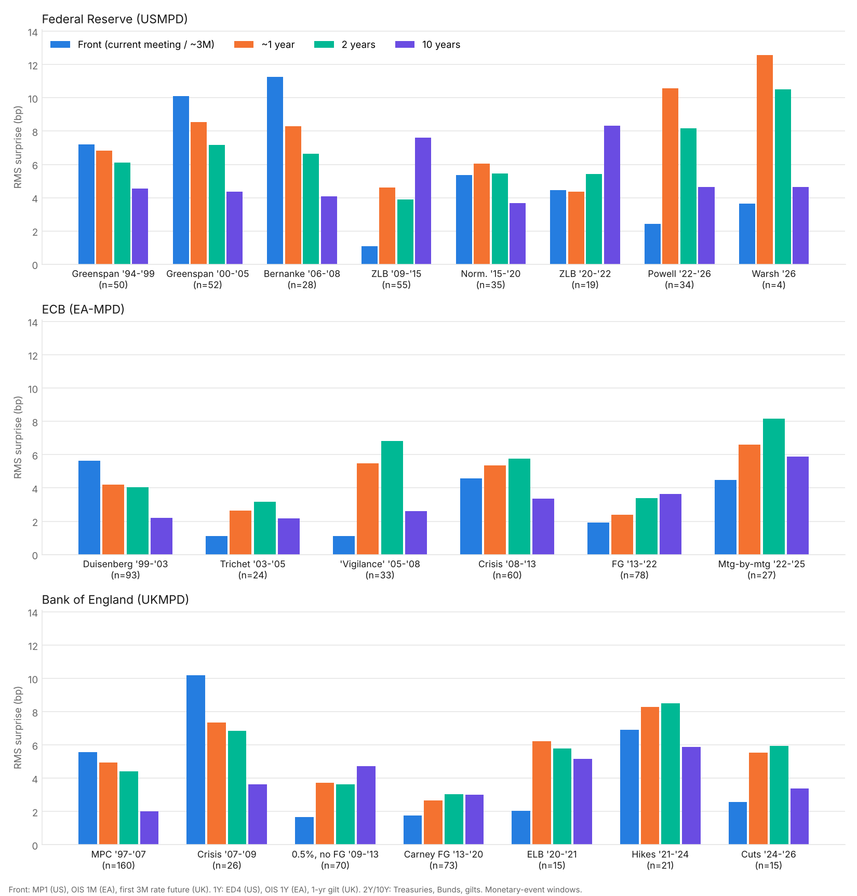
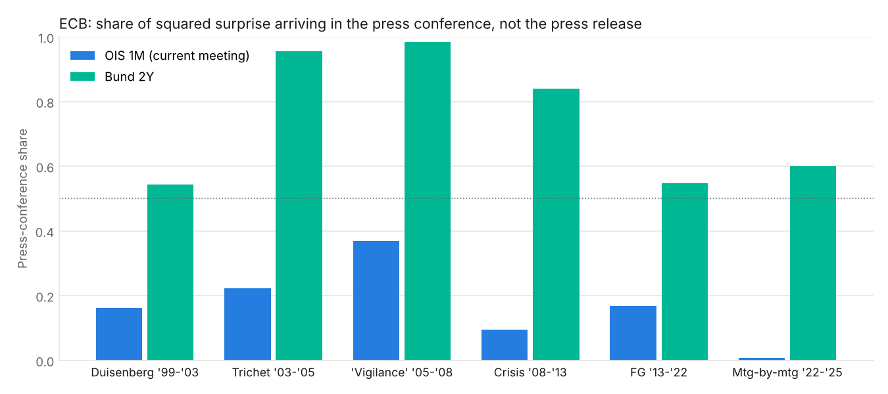

# Where do FOMC surprises land? Near-term forward guidance across chairs, 1994–2026

*Empirical note, draft, November 2026. Code: `scripts/10_forward_guidance_note.py`, `scripts/11_fg_cross_country.py`. Data: SF Fed USMPD (277 FOMC events, Feb 1994 – Oct 2026), ECB EA-MPD (315 meetings, 1999 – Oct 2025), BoE UKMPD (380 MPC decisions, 1997 – Apr 2026).*

## 1. The question

Forward guidance is under attack, most visibly from the new Fed chair. At his first meeting (June 17, 2026) Kevin Warsh cut the statement down, dropped forward guidance and said "I can't give you any forward guidance about what we're going to do next." This note uses a simple measurement to judge the debate empirically. **If near-term guidance works, markets should already know what the Fed will do at this meeting and over the next year or two. Announcement-window surprises should then be small at the front of the curve (the current meeting, 3 months, 1 year and 2 years) relative to long rates.** Where the surprise lands on the curve is a revealed-preference measure of how much near-term guidance is in effect.

## 2. Measurement

For each FOMC event the USMPD records tight-window changes (30 min, or 70–100 min when there is a press conference) in:

| Horizon | Instrument |
|---|---|
| Current meeting | MP1 (Kuttner surprise in fed funds futures) |
| ~3 months | FF4 |
| ~1 year | ED4 (Eurodollar, later SOFR, futures). USMPD has no 1-yr Treasury; OIS1Y from 2004 is used as a check. |
| 2 years / 10 years | UST2Y, UST10Y |

Statistics by era (all in bp):

* **RMS surprise** at each horizon.
* **Path share**: the Gürkaynak–Sack–Swanson (2005) decomposition of [MP1, FF4, ED2, ED3, ED4] into a *target* factor and a *path* factor. The path factor has no effect on the current meeting. The path share is path² / (path² + target²).
* **Front/10Y ratio**: RMS(2Y) / RMS(10Y). Above 1 means the news is mainly about the near-term policy path. Below 1 means it is mainly about long rates (QE, term premia).
* **Guidance events**: the share of meetings with |MP1| < 1 bp but |2Y| ≥ 5 bp. These are pure path news: the decision itself was known, the path was not.

Eras: Greenspan 1994–99; Greenspan 2000–Jan 2006; Bernanke pre-ZLB; ZLB 2009–15; normalization 2015–20; ZLB 2020–22; Powell 2022–May 2026; Warsh (June 2026 onward, **4 meetings**). The event filter is the same as the dashboard's: non-policy unscheduled events with MP1 = 0 are dropped.

## 3. Results

| Era | n | MP1 | FF4 | ED4 (1y) | 2Y | 10Y | 2Y/10Y | Path share | Guidance events |
|---|---|---|---|---|---|---|---|---|---|
| Greenspan 1994–99 | 50 | 7.2 | 4.8 | 6.8 | 6.1 | 4.6 | 1.34 | 0.46 | 4% |
| Greenspan 2000–03 | 31 | 13.1 | 9.9 | 9.1 | 8.1 | 4.1 | 1.96 | 0.24 | 3% |
| Greenspan Aug 2003–Jan 2006 ("considerable period"/"measured pace") | 21 | **1.2** | **1.5** | 7.7 | 5.6 | 4.7 | 1.18 | **0.92** | 19% |
| Bernanke 2006–08 | 28 | 11.3 | 7.0 | 8.3 | 6.7 | 4.1 | 1.63 | 0.33 | 7% |
| ZLB 2009–15 | 55 | 1.1 | 1.2 | 4.6 | 3.9 | **7.6** | **0.51** | 0.89 | 16% |
| Normalization 2015–20 | 35 | 5.4 | 3.5 | 6.0 | 5.5 | 3.7 | 1.49 | 0.56 | 11% |
| ZLB 2020–22 | 19 | 4.5 | 1.6 | 4.4 | 5.4 | **8.3** | **0.65** | 0.59 | 5% |
| Powell 2022–23 (hikes) | 15 | 1.8 | 3.9 | **14.0** | **10.5** | 5.5 | 1.90 | 0.96 | **47%** |
| Powell 2024–May 2026 | 19 | 2.9 | 3.6 | 6.9 | 5.6 | 3.8 | 1.50 | 0.79 | 37% |
| **Warsh, Jun–Oct 2026** | 4 | 3.6 | **8.1** | **12.6** | **10.5** | 4.7 | **2.26** | 0.89 | 25% |

Full table (with bootstrap bands and OIS1Y): `fg_note/era_table.csv`. The ZLB 2020–22 and Greenspan 2000–03 rows include large intermeeting cuts. Dropping unscheduled events lowers their MP1 sharply but leaves the conclusions unchanged (`output/fg_era_table_scheduled.csv`).

**Finding 1: the ZLB shows forward guidance clearly, but at the long end.** In 2009–15, current-meeting and 3-month surprises are about 1 bp. One- and two-year surprises shrink to 4–5 bp, while 10-year surprises roughly double to 7.6 bp. The 2Y/10Y ratio is the only sustained stretch below 1 in the sample. Its troughs are about 0.3, in 2010–11 (QE2) and 2013–14 (taper). The 2Y reactivates in late 2014, ahead of liftoff (the Swanson–Williams pattern, also used in `01_load_full_sample.py`). ZLB 2020–22 shows the same pattern. Calendar and threshold guidance pinned the 1–2 year sector, and the remaining news moved out to term premia and the expected length of the zero rate period.

**Finding 2: the Greenspan shift is from the 1990s to 2003–05, not to "the 2000s" as a whole.** Splitting Greenspan's 2000s at August 2003 matters:

* **2000–03** looks like the 1990s, only with more surprise: MP1 at 13 bp and a path share of 0.24. Policy surprises were mostly surprises about the decision itself.
* **Aug 2003–Jan 2006** ("considerable period", then "measured pace") is where the regime changes. MP1 falls from 7.2 bp in the 1990s to 1.2 bp, and FF4 from 4.8 to 1.5. Both declines are significant on a permutation test, p < 0.001. The path share jumps from about 0.2–0.5 to 0.92, about the ZLB level.
* The 1-yr and 2-yr surprises did **not** fall (7.7 and 5.6 bp vs 6.8 and 6.1 bp; p = 0.67 and 0.41). Guidance with a positive policy rate eliminated surprises at the 0–3 month horizon. It moved uncertainty to the 1–2 year horizon instead of removing it.

**Finding 3: 2022–26 is "guidance about the meeting, not about the path."** Under Powell after liftoff, MP1 stays small (1.8–2.9 bp): decisions were telegraphed through speeches, the SEP and press leaks. Surprises at 1 year (14 bp) and 2 years (10.5 bp) in 2022–23 are the largest for any era in the sample. Nearly half of meetings (47%) were pure path news. The path share is at its sample high (0.96). This is the signature of "meeting-by-meeting, data-dependent" policy: the market knew what the Fed would do in the meeting, but not what it would do next. The 2024–26 period is calmer but has the same structure.

**Finding 4: Warsh. Dropping guidance raised front-end surprises, not meeting-day surprises.** Over Warsh's four meetings:

* RMS surprises at 3 months (8.1 bp), 1 year (12.6 bp) and 2 years (10.5 bp) are about double the 2024–26 Powell average.
* By permutation test against Powell 2024–26 meetings: FF4 p = 0.008, ED4 p = 0.021, 2Y p = 0.012.
* MP1 (p = 0.18) and the 10-year (p = 0.23) are not unusual.
* The 2Y/10Y ratio of 2.26 is the highest of any era.

June 2026 is the clearest case: MP1 = 0 and the decision was fully expected, yet the 2Y rose 14 bp and ED4 16.5 bp. That move combines the stripped statement with projections showing hikes. In July and October the 2Y fell while the 10Y rose (+2 bp each time). That twist is very rare: 2Y down at least 3 bp with 10Y up at least 2 bp happened at only 2 of the 273 earlier events (Sept 17, 2001 and Nov 4, 2009), and at 2 of Warsh's 4. It is a candidate signature of a credibility or term-premium channel.

**Caveats.** Four meetings is not a regime. The June meeting combines a new chair, a new statement format and a hawkish SEP, so "first-meeting news" and "no guidance" cannot be separated yet. The Warsh results also hold only against the calm 2024–26 benchmark. Against all of Powell 2022–26, which includes the 2022 hiking shock, the 1y and 2y differences are not significant (p ≈ 0.2). The window length changed with press conferences (2011 on, every meeting since 2019), which mechanically raises path news later in the sample. ED4 changed from Eurodollar to SOFR futures in 2022. The 2Y/10Y ratio mixes path news with term-premium news.

## 4. Cross-country: ECB and Bank of England

Two databases built to the same design make it possible to rerun the exercise for the ECB and the Bank of England:

* **EA-MPD** (Altavilla, Brugnolini, Gürkaynak, Motto and Ragusa 2019): 315 ECB meetings, January 1999 – October 2025. It has separate press-release and press-conference windows.
* **UKMPD** (Braun, Miranda-Agrippino and Saha 2024): 380 MPC decisions, June 1997 – April 2026, with the database's own target and path factors. An MPC announcement and a same-day press conference are summed into one event, matching the US "Monetary Events" window.

The horizons are matched as closely as the data allow:

| | Fed | ECB | BoE |
|---|---|---|---|
| Front | MP1 (current meeting) | OIS 1M (≈ current meeting) | first 3-month rate future (Libor, SONIA from 2021) |
| ~1 year | ED4 | OIS 1Y | 1-yr gilt |
| 2 / 10 years | Treasuries | Bunds | gilts |

The UK front instrument covers about the next three months, not just the current meeting, so UK front numbers are not strictly comparable. For the ECB the path share is a GSS rotation of OIS 1M–1Y computed here; for the UK it uses the UKMPD factors. Code: `scripts/11_fg_cross_country.py`. Tables: `fg_note/era_table_ea.csv`, `era_table_uk.csv`, `common_windows.csv`.

**ECB** (RMS surprise in bp)

| Era | n | Front | 1Y | 2Y | 10Y | 2Y/10Y | Path share |
|---|---|---|---|---|---|---|---|
| Duisenberg 1999–2003 | 93 | 5.7 | 4.2 | 4.1 | 2.2 | 1.85 | 0.24 |
| Trichet 2003–05 | 24 | 1.1 | 2.6 | 3.2 | 2.2 | 1.46 | 0.82 |
| Trichet "strong vigilance" Nov 2005–Jul 2008 | 33 | **1.1** | 5.5 | **6.8** | 2.6 | **2.61** | **0.95** |
| Crisis, no guidance 2008–Jun 2013 | 60 | 4.6 | 5.4 | 5.8 | 3.4 | 1.72 | 0.51 |
| Forward guidance Jul 2013–Jun 2022 | 78 | 1.9 | **2.4** | **3.4** | 3.6 | **0.93** | 0.46 |
| Meeting-by-meeting Jul 2022–Oct 2025 | 27 | 4.5 | **6.6** | **8.2** | 5.9 | 1.38 | 0.63 |

**Bank of England**

| Era | n | Front | 1Y | 2Y | 10Y | 2Y/10Y | Path share |
|---|---|---|---|---|---|---|---|
| MPC pre-crisis 1997–2007 | 160 | 5.6 | 5.0 | 4.4 | 2.0 | 2.21 | 0.23 |
| Crisis cuts 2007–09 | 26 | 10.2 | 7.3 | 6.9 | 3.6 | 1.89 | 0.17 |
| Bank Rate 0.5%, no guidance 2009–13 | 70 | 1.7 | 3.7 | 3.6 | 4.7 | 0.77 | 0.82 |
| Carney forward guidance Aug 2013–2020 | 73 | 1.8 | 2.7 | 3.0 | 3.0 | 1.01 | 0.53 |
| COVID lower bound 2020–21 | 15 | 2.1 | 6.2 | 5.8 | 5.2 | 1.12 | 0.71 |
| Hikes, meeting-by-meeting Dec 2021–Jun 2024 | 21 | **6.9** | **8.3** | **8.5** | 5.9 | 1.45 | 0.48 |
| Cuts, "gradual and careful" Aug 2024–Apr 2026 | 15 | 2.6 | 5.6 | 6.0 | 3.4 | 1.76 | 0.88 |

**Finding 5: Trichet's "strong vigilance" repeats Greenspan 2003–05.** "Strong vigilance" was the ECB's code phrase signalling a hike at the next meeting. While it was in use:

* Current-meeting surprises fell to 1.1 bp, against 5.1 bp in 1999–2005 (p = 0.001).
* 2-year surprises did not fall. They rose, to 6.8 bp from 3.9 bp.
* The path share reached 0.95, and 98% of the squared 2-year surprise arrived in the press conference, where the code words were delivered (figure 6).

This is the same pattern as Greenspan's "measured pace": coded near-term guidance with a positive policy rate removes surprises about the next meeting and leaves the 1–2 year path uncertain.

**Finding 6: explicit ECB forward guidance (2013–22) pinned the 1–2 year sector without moving surprises to the long end.** Compared with 2008–13:

* 1-year surprises fell from 5.4 to 2.4 bp (p < 0.001) and 2-year surprises from 5.8 to 3.4 bp (p = 0.002).
* The 10-year was unchanged (3.6 vs 3.3 bp).
* The 2Y/10Y ratio fell below 1, as it did at the Fed's ZLB. Unlike at the Fed, long-end surprises did not grow. One possible reason is that ECB asset purchases started later and were announced on a more predictable schedule.

Guidance also changed where the news arrived. The press-conference share of the 2-year surprise fell from 0.84 to 0.55. Once guidance was written into the statement, path news moved from Draghi's answers into the press release.

**Finding 7: the ECB already ran the Warsh experiment.** At its July 2022 meeting the ECB dropped rate guidance and moved to "meeting-by-meeting" decisions. Compared with 2013–22:

* 1-year surprises nearly tripled (2.4 → 6.6 bp, p < 0.001) and 2-year surprises more than doubled (3.4 → 8.2 bp, p < 0.001).
* The front rose to 4.5 bp (p = 0.05). The 10-year rose too, by less (3.6 → 5.9 bp, p = 0.02).
* Almost all of the current-meeting surprise (99%) now arrives in the press release, with the decision itself.

The Bank of England, which kept softer guidance ("gradual and careful"), shows the same structure as Powell's 2024–26 Fed: a small front, larger 1–2 year surprises, and a path share of 0.88.

**Finding 8: Carney's guidance changed little at the front.** UK front and 1–2 year surprises were already small at the 0.5% Bank Rate in 2009–13. Threshold guidance from August 2013 did not reduce them further (2Y 3.6 → 3.0 bp, p = 0.19). Only the 10-year fell (4.7 → 3.0 bp, p = 0.01). This matches the view at the time that Carney's thresholds had limited credibility.

**Same calendar, three central banks.** The 2022–25 inflation shock hit all three, so comparing the same window controls for the common shock. From 2013–19 to Jul 2022–Oct 2025, 2-year surprises rose:

* Fed 5.1 → 8.1 bp (1.6x)
* BoE 2.9 → 5.0 bp (1.7x)
* ECB 3.2 → 8.2 bp (2.6x)

The ECB was the one that formally dropped guidance, and it had the largest rise. Its 2Y/10Y ratio went from 0.82 to 1.38.

**Caveats.** Before November 2001 the ECB met twice a month, and many of those meetings made no decision, so Duisenberg-era RMS numbers are diluted. The ECB "crisis" era mixes the 2008 cuts with the 2010–12 sovereign debt crisis, which moved Bund yields through flight-to-safety channels. ECB meeting-by-meeting begins with a 50 bp hike that surprised markets and a new crisis tool (TPI) at the same meeting, so dropping guidance is confounded with the start of the hiking cycle. The common-window comparison helps but does not fully solve this. The UK front instrument changes from Libor to SONIA futures in 2021.

## 5. Implications and research questions

1. **Guidance moves surprises along the curve rather than removing them.** In 2003–05, at the ZLB and under Powell, guidance (or telegraphed decisions) eliminated meeting-day surprises. The uncertainty did not disappear. It showed up at the 1–2 year horizon (2003–05, 2022–26) or the 10-year (ZLB). A natural test of the critics' claim is whether *total* surprise variance (summed over the curve, or measured as a variance-weighted duration) is lower under guidance. Here it is not obviously lower.
2. **Is the Warsh shift a level shift or a first-meeting transition?** Prediction: if dropping guidance permanently raises 3m–2y surprise variance, the Warsh numbers should stay roughly 2x the 2024–26 Powell level. If June was a one-time reset, they should revert. Every new meeting adds a point; the script reruns on the live USMPD file.
3. **Do larger front-end surprises pass through more to the real economy?** The 2Y-to-corporate-spread and 2Y-to-equity pass-through estimates on the dashboard (`02_production_estimates.py`) can be split by guidance regime. If the 1–2 year sector drives credit conditions, a no-guidance Fed has more power per meeting and more volatility per meeting.
4. **Is the Greenspan 2003–05 regime the right model for Warsh?** Commentary has compared Warsh's approach to Greenspan's. The data separate two very different Greenspan regimes: the 1990s (surprise about the decision, path share ~0.4) and 2003–05 (no surprise about the decision, path share ~0.9). If "Greenspan-style" means the 1990s, MP1 surprises should rise again. So far they have not: Warsh's path share is 0.89.
5. **What explains the 2Y-down/10Y-up twist?** Event-level decomposition of the July and October 2026 meetings using TIPS (inflation compensation vs real) and the dashboard's OIS curve would show whether long-end selloffs on dovish front-end news reflect inflation risk premia under a less predictable Fed.
6. **The ECB 2022 exit as a template for Warsh.** The ECB results suggest what to expect if Warsh's approach lasts: 1–2 year surprises about 2–2.5x the guidance-era level, plus some spillover to the 10-year. The US data can be checked against that benchmark meeting by meeting. A natural next step is a difference-in-differences across the three central banks around each one's guidance changes (Fed 2026, ECB 2022, BoE 2013), using the other two as controls for global shocks.
7. **Code words versus formal guidance.** Greenspan's "measured pace" and Trichet's "strong vigilance" both eliminated next-meeting surprises but not path surprises. Formal ECB guidance (2013–22) pinned the 1–2 year sector itself. Does guidance tied to a horizon or to conditions matter more than guidance about the next meeting? And would a Warsh Fed that gives no guidance still produce informal code words?
8. **Measurement extensions.** Add the Bauer–Swanson (2023) orthogonalized surprise, and use the USMPD statement/press-conference split to repeat the ECB "where does path news arrive" exercise for the Fed. That would also test whether Warsh's shorter statements moved path news into the press conference.

---
*Reproduce:* `cd scripts && python3 00_fetch_usmpd.py && python3 00_fetch_intl_mpd.py && python3 10_forward_guidance_note.py && python3 11_fg_cross_country.py` (needs pandas, numpy, statsmodels, matplotlib, openpyxl). The Bank of England site can refuse scripted downloads; if so, the fetch script prints the URL and the file name to save it under. Console output includes the permutation tests quoted above.
